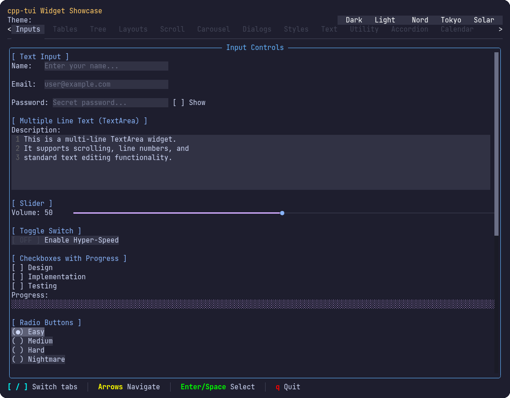
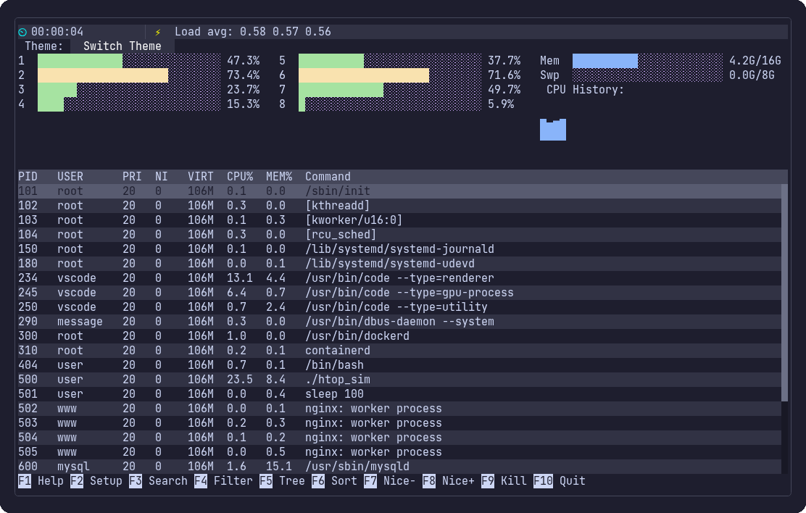
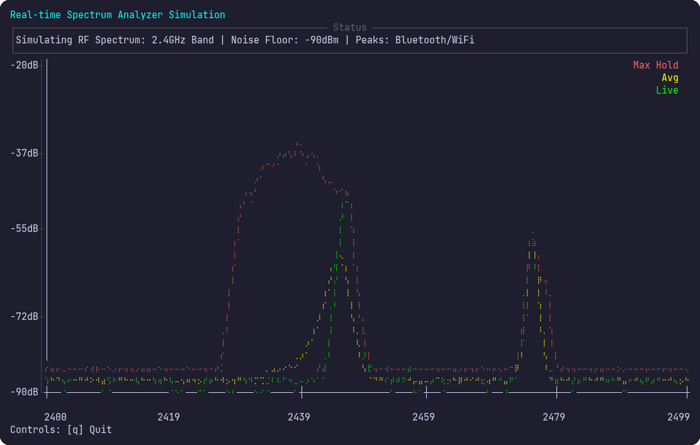

<h1 align="center">cpp-tui</h1>

<p align="center">
  <strong>A lightweight, single-header C++17 library for building terminal user interfaces.</strong>
</p>

<p align="center">
  <a href="https://en.cppreference.com/w/cpp/17"></a>
  
  
  <a href="LICENSE"></a>
  <a href="https://jonoton.github.io/cpp-tui/"></a>
</p>

<p align="center">
  <picture>
    <source media="(max-width: 640px) and (prefers-reduced-motion: reduce)" srcset="docs/assets/img/widget_demo_mobile.png">
    <source media="(max-width: 640px)" srcset="docs/assets/img/widget_demo_mobile.gif">
    <source media="(prefers-reduced-motion: reduce)" srcset="docs/assets/img/widget_demo.png">
    
  </picture>
</p>
<p align="center">
  <picture>
    <source media="(prefers-reduced-motion: reduce)" srcset="docs/assets/img/htop_sim.png">
    
  </picture>
  <picture>
    <source media="(prefers-reduced-motion: reduce)" srcset="docs/assets/img/spectrum_sim.png">
    
  </picture>
</p>

## Highlights

- **One header, no dependencies** — copy `cpptui.hpp` into your project and `#include` it.
- **50+ widgets** — inputs, editors, tables, trees, tabs, dialogs, menus, and Braille charts.
- **Flex layouts** — `Vertical`, `Horizontal`, `Grid`, `SplitPane`, and scrollable containers with min/max constraints.
- **Themes** — Catppuccin Mocha and Latte, Nord, Tokyo Night, and Solarized Light, switchable at runtime.
- **Full input** — keyboard shortcuts with modifiers, mouse click, drag, wheel and hover, focus navigation, and clipboard.
- **Thread-safe updates** — change the UI from worker threads with `app.post()`.
- **Unicode-aware** — correct cell widths for CJK and emoji. Works on Windows, Linux, and macOS.

## Quick start

`main.cpp`: a label, a button that counts clicks, and <kbd>q</kbd> to quit.

```cpp
#include "cpptui.hpp"
using namespace cpptui;

int main() {
    App app;
    auto root = std::make_shared<Vertical>();
    auto label = std::make_shared<Label>("Hello, cpp-tui!");
    root->add(label);
    root->add(std::make_shared<Button>("Click me", [label, clicks = 0]() mutable {
        label->set_text("Clicked " + std::to_string(++clicks) + " times");
    }));

    app.register_exit_key('q');
    app.run(root);
}
```

Grab the single header and build. You need a C++17 compiler with `<filesystem>`: GCC 9+, Clang 9+, MSVC 2019+ (`cl /std:c++17 /utf-8 main.cpp`) or Xcode 11+.

```bash
curl -O https://raw.githubusercontent.com/jonoton/cpp-tui/main/cpptui.hpp
g++ -std=c++17 -O2 main.cpp -o my_app && ./my_app
```

Or add it with CMake:

```cmake
include(FetchContent)
FetchContent_Declare(cpptui
    GIT_REPOSITORY https://github.com/jonoton/cpp-tui.git
    GIT_TAG        main)   # or pin a release tag
FetchContent_MakeAvailable(cpptui)

target_link_libraries(my_app PRIVATE cpptui::cpptui)
```

## Examples

```bash
cmake -S . -B build && cmake --build build
./build/widget_demo   # also: chart_demo, htop_sim, editor, spectrum_sim, key_events, ...
```

Browse the [`examples/`](examples) folder, or see the [examples list](https://jonoton.github.io/cpp-tui/getting-started#examples) for what each program shows.

## Documentation

**[jonoton.github.io/cpp-tui](https://jonoton.github.io/cpp-tui/)** —
[Getting Started](https://jonoton.github.io/cpp-tui/getting-started) ·
[Core Concepts](https://jonoton.github.io/cpp-tui/core-concepts) ·
[API Reference](https://jonoton.github.io/cpp-tui/api-reference) ·
[Troubleshooting](https://jonoton.github.io/cpp-tui/troubleshooting)

<sub>Screenshots and GIFs are recorded from the real example programs. Regenerate them with `scripts/screenshots/generate.sh` (needs CMake, Python 3, Node.js and Chrome or Chromium).</sub>

## License

[MIT](LICENSE)
